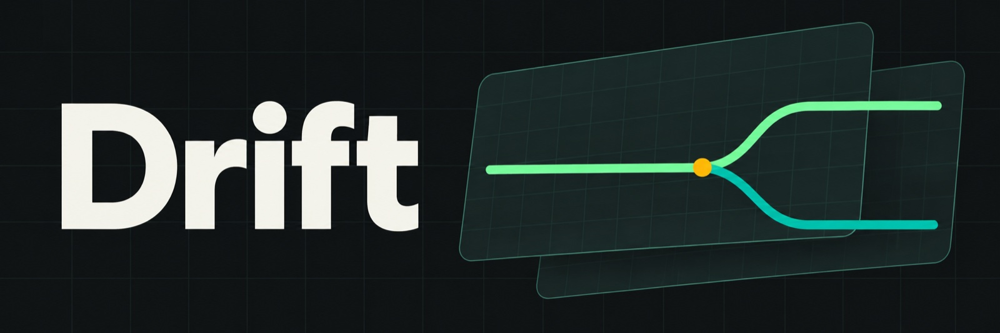
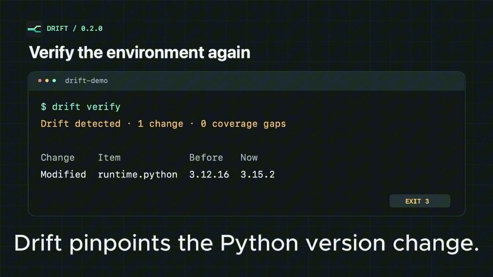

<h1 align="center">
  
</h1>

<p align="center">
  
  <br>
  <strong>Track what changed in your development environment.</strong>
</p>

<p align="center">
  <a href="https://pypi.org/project/drift-dev-env/"></a>
  <a href="https://github.com/KiraQiez/Drift/actions/workflows/quality.yml?query=branch%3Amain"></a>
  <a href="pyproject.toml"></a>
  <a href="LICENSE"></a>
</p>

<p align="center">
  <a href="#install">Install</a> ·
  <a href="#use-drift-in-a-project">Use Drift</a> ·
  <a href="#see-it-work">See it work</a> ·
  <a href="#documentation">Docs</a>
</p>

Drift is a command-line tool for comparing your current setup with a snapshot you saved when the project worked. It can spot a runtime upgrade, a changed lockfile, or a change in Docker availability. Snapshots stay in the project’s `.drift/` directory, and environment variables are recorded by name only.

## Install

**macOS with Homebrew**

```sh
brew install KiraQiez/tap/drift
drift --version
```

| Other installers | Command |
| --- | --- |
| uv | `uv tool install drift-dev-env` |
| pipx | `pipx install drift-dev-env` |

uv and pipx work on macOS, Linux, and Windows. Drift requires Python 3.12 or newer.

## Use Drift in a project

This workflow is available in Drift 0.2.0 and later. For an older installation, see the [v0.1.0 workflow](https://github.com/KiraQiez/Drift/blob/v0.1.0/README.md#workflow).

Open a terminal in a working project and save its baseline.

```sh
drift snapshot --baseline -m "Working environment"
```

This sets up local Drift files if needed, captures the current environment, and makes that snapshot the baseline. When a runtime changes, a lockfile is updated, or a command stops working, run this from the same project.

```sh
drift verify
```

After an intentional change, rerun `drift snapshot --baseline` to adopt the new setup. Earlier snapshots remain in `drift history`. To select an earlier baseline, use `drift baseline set SNAPSHOT_ID`.

| When you want to… | Run |
| --- | --- |
| Compare against your known-working baseline | `drift verify` |
| Compare against the latest snapshot | `drift diff` |
| Compare against another snapshot | `drift diff SNAPSHOT_ID` |
| Inspect the contents of a snapshot | `drift show SNAPSHOT_ID` |
| Use the baseline result in a script | `drift verify --json` |

For `drift verify`, exit code **0** means a match, **3** means a confirmed change, and **4** means the comparison had gaps and found no confirmed change. [Full exit-code reference](docs/CLI_SPEC.md#exit-codes-and-errors)

## See it work

[](docs/assets/drift-demo.mp4)

[Watch the 33-second demo](docs/assets/drift-demo.mp4) to see Drift save a baseline and detect a Python version change.

Here’s what Drift reports after a line changes in `requirements.txt`. Use `drift diff --details` for full dependency hashes and Git context.

```text
$ drift diff
Drift detected · 1 change · 0 coverage gaps
Reference 94eb33b51c6f41cb81949389e1ab3628 · Before the change
Modified  requirements.txt  4407602260ca… → a5e38db64fae…
```

<details>
<summary>Run this demo in a temporary project on macOS or Linux</summary>

Paste this into your terminal after installing Drift. The demo enables only the dependency collector so the manifest change is easy to see.

```sh
(
  set -e
  cd "$(mktemp -d)"
  drift init

  cat > drift.toml <<'EOF'
schema_version = 1

[collectors]
system = false
runtime = false
docker = false
environment = false
git = false
EOF

  printf 'demo==1.0\n' > requirements.txt
  drift snapshot -m "Before the change"
  printf 'demo==2.0\n' > requirements.txt
  drift diff || test "$?" -eq 3
)
```

</details>

## Run from source

From a checkout with uv installed, run the source CLI.

```sh
uv sync --locked
uv run --locked drift --help
```

From the Drift checkout, replace `/path/to/project` with your project’s directory.

```sh
uv run --locked drift --project /path/to/project snapshot --baseline
uv run --locked drift --project /path/to/project verify
```

Run `just check` for lint, type checks, and tests if you have Just installed.

## Documentation

| Topic | Guide |
| --- | --- |
| All commands and options | [CLI specification](docs/CLI_SPEC.md) |
| Configuration and snapshot storage | [Data model](docs/DATA_MODEL.md) |
| What Drift collects | [Security and privacy](docs/SECURITY.md) |
| Project design and scope | [Architecture](docs/ARCHITECTURE.md) · [Product requirements](docs/PRD.md) |
| Development and conventions | [Development guide](docs/DEVELOPMENT.md) · [Contribution rules](RULES.md) |
| Releases and implementation status | [Release guide](docs/RELEASE.md) · [Roadmap](docs/ROADMAP.md) |

The guides in `docs/` are for contributors and AI agents. [AGENTS.md](AGENTS.md) points AI agents to their workflow rules in `.ai/rules/`.

[Apache License 2.0](LICENSE)
