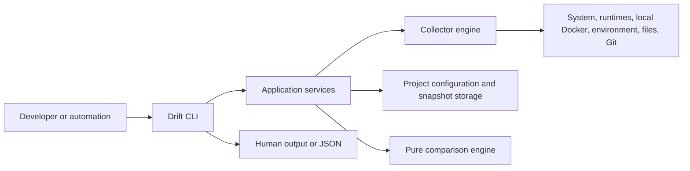
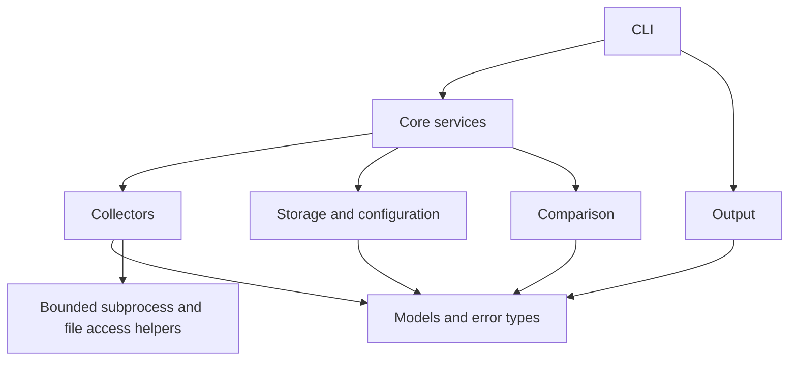
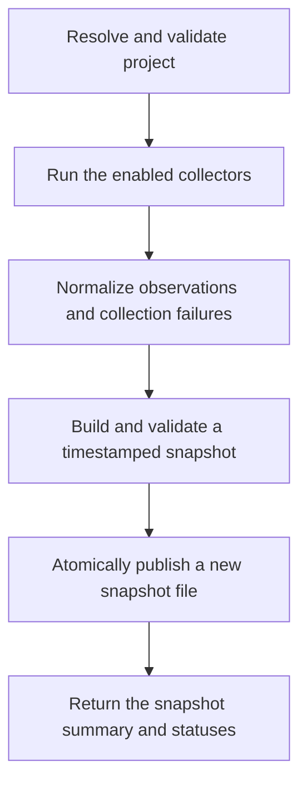
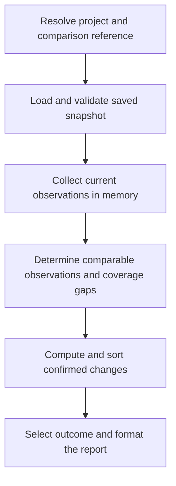

# Architecture

Drift is a modular monolith that runs for one command at a time. A command resolves one project, invokes application services, and formats their results. The only persistent state is the project's configuration and local JSON files. See [CLI specification](CLI_SPEC.md) and [data model](DATA_MODEL.md) for the public contracts.

## System overview

## Responsibilities and dependency direction

| Component | Responsibility |
| --- | --- |
| CLI and output | Parse input, invoke a service, translate its result or error to the public exit code, and render through Rich or a JSON serializer. |
| Application services | Resolve project context and coordinate init, capture, history, show, compare, and baseline operations. Start with functions in the relevant core modules. |
| Collector engine | Run the fixed collector registry with independent deadlines, normalize results, and return a stable mapping of collector IDs to typed results. |
| Snapshot and baseline | Assemble snapshots, identify references, and manage a validated baseline pointer through the storage module. |
| Comparison | Compare normalized observations using scope and coverage metadata. Return changes, gaps, and Git context as structured data. |
| Storage and configuration | Resolve and validate project paths, read versioned inputs, and publish durable local state with the rules in the data model. |

Use simple functions and a fixed internal collector registry. Each collector receives a read-only context with the resolved root, its validated settings, and the probe deadline. It returns typed results independent of terminal output. Keep subprocess execution and safe file access reusable at the collector boundary. Add a future collector through the registry, schemas, and compatibility tests.

Start runtime detection with `python -I -S --version` (try `python3` only when `python` is absent), `node --version`, `npm --version`, `php -n -v`, `java -version`, and `go version`. The [security design](SECURITY.md#subprocess-safety) defines launcher and environment restrictions. Parse a version token specific to each tool, including the Java version line on stderr. Treat unrecognized output as a failed probe. System probes use `platform` for the OS, OS version, and machine architecture, with the macOS product version preferred over the Darwin kernel release.

## Capture and comparison

### Snapshot creation

### Live comparison

### Execution limits

Run at most six collectors concurrently, with one worker per enabled collector. Use a two-second timeout per subprocess and an eight-second budget per collector, measured with a monotonic clock. Each probe gets at most its collector's remaining time. Limit captured subprocess output to 256 KiB combined, terminate and reap a probe on timeout or overflow, and record a bounded failure code. File-based collectors stop between chunks or files when their budget is exhausted and preserve completed observations. A synchronous filesystem call can still stall inside the OS, so the file budget is cooperative. Support local filesystems for project data and document the limitation.

Translate expected command, parse, and file failures to per-probe statuses or typed application errors. An unexpected collector error becomes a sanitized collector failure with a diagnostic code. Errors loading required configuration or reference data stop the dependent operation. History can report individual read failures alongside readable entries. Readers observe complete files. Independent snapshot writes avoid a shared mutable index. Baseline updates replace one metadata file. See [storage and comparison](DATA_MODEL.md) for concurrency and recovery behavior.

## Planned repository layout

- `src/drift/` contains `cli.py`, `output.py`, `models.py`, `config.py`, `storage.py`, and `exceptions.py` as their tasks require them.
- `src/drift/collectors/` contains the shared runner and contract, plus the system, runtime, Docker, environment, dependency, and Git modules.
- `src/drift/core/` contains snapshot and history orchestration, comparison, and baseline management. Initialization can use the configuration and storage modules directly.
- `tests/unit/`, `tests/integration/`, and `.github/workflows/` arrive with the appropriate tasks. The root will hold the package metadata, uv lockfile, Justfile, Python version file, and license.

## Technology stack

| Layer | Technology | Why it fits |
| --- | --- | --- |
| Application | Python 3.12+ | Provides standard-library primitives for local files, processes, hashing, timestamps, and concurrency. |
| CLI | Typer and Rich | Typer provides typed commands and help. Rich formats human reports. The standard JSON encoder handles machine output. |
| Validation | Pydantic | Validates configuration, observations, and persisted records at their boundaries. |
| Configuration and storage | TOML with `tomllib`, JSON for state | Keeps configuration editable and state inspectable. Initialization can use a static TOML template. |
| Development | uv, Just, Pytest, Ruff, Mypy, Git, and GitHub Actions | Provides a locked [development environment and quality gates](DEVELOPMENT.md#quality-gates-and-ci). |
| Build and distribution | Hatchling, PyPI, Homebrew tap, and GitHub Releases | Builds the wheel and sdist from the Python `src` layout for the [release pipeline](RELEASE.md#release-pipeline). |

Typer, Rich, and Pydantic are the initial direct runtime dependencies. Package metadata declares compatibility and runtime requirements for isolated public installs.

## Design decisions

| ID | Status | Decision and rationale | Alternative and consequence |
| --- | --- | --- | --- |
| ADR-001 | Accepted | Use Python for local process orchestration and packaging. Use Typer and Pydantic for CLI handling and validation. | Go simplifies single-binary distribution. Argparse and handwritten validation reduce dependencies but add plumbing. Python installers must provision a supported interpreter. |
| ADR-002 | Accepted | Store immutable snapshots and one baseline pointer as local JSON. | SQLite could index large histories. An append-only log can complicate recovery and concurrent writes. The MVP scans canonical files for history. |
| ADR-003 | Accepted | Keep data on the user's machine. Capture active variable names with an optional allowlist. | Cloud storage introduces access and retention concerns. Explicit-name-only capture would leave a new project with an empty active inventory. |
| ADR-004 | Accepted | Use a modular monolith with independent collectors and a pure comparator inside one package. | A flat script offers fewer files at first. A public plugin architecture or separate services would add compatibility and operational obligations. |
| ADR-005 | Accepted | Keep readable history and report coverage gaps separately from confirmed drift. Automatic latest selection stops on damaged entries. | Failing the entire listing hides useful history. Giving incomplete coverage exit-code precedence can obscure confirmed drift in automation. [CLI contract](CLI_SPEC.md#exit-codes-and-errors) |
| ADR-006 | Accepted | Publish staged snapshots without clobbering and atomically replace the baseline pointer. | A shared index or global lock would require coordination and recovery. Writes require supported local filesystem operations. [Storage and recovery](DATA_MODEL.md#storage-and-recovery) |
| ADR-007 | Deferred to T-019 | Use Drift and `drift` provisionally while verifying public identities. | A distinct distribution name may keep the same console script. Revisit public naming if collision checks warrant it. [Release identity](RELEASE.md#release-identity) |
