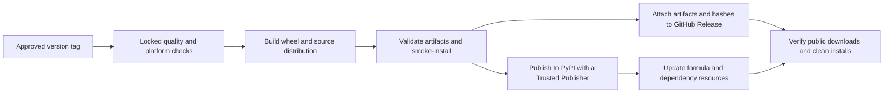

# Release and distribution

## Release identity

Use Drift as the working project name and `drift` as the proposed console script and tap formula name. The exact `drift` PyPI project name is occupied. Before configuring publication, verify a distinct normalized distribution name, check for product, import, formula, and executable collisions, and confirm the maintainer-controlled GitHub and tap paths. Use the chosen distribution name in metadata and installation instructions. The Python distribution and console script can have different names. [Existing PyPI project](https://pypi.org/project/drift/)

```sh
brew install OWNER/tap/drift
uv tool install PACKAGE_NAME
pipx install PACKAGE_NAME
```

These are planned installations from the project's own tap and PyPI package. Each installer manages the application's Python environment.

## Artifacts and versioning

Build a wheel and sdist with Hatchling through `uv build`. Package the `src` code and console script along with runtime dependency declarations, the README, and the Apache 2.0 license. Keep development tools, temporary projects, and local Drift state out of release packages. Verify file contents and metadata for both artifact types. Smoke-install the exact artifacts that will ship, then calculate and record their SHA-256 digests.

Use SemVer and a matching Git tag of the form `vMAJOR.MINOR.PATCH`. Use `0.1.0` as the starting target for the first public release. Check that the tag, package metadata, and CLI version agree. Record user-visible changes, fixes, compatibility notes, and manual upgrade steps in a maintained changelog. Persisted schema versions follow the separate [data model](DATA_MODEL.md#json-schema-v1).

## Release pipeline



Run quality checks for pull requests and again on every release tag. Pin workflow actions to reviewed commit SHAs. The publish workflow consumes the validated artifacts from the tagged commit. Grant `id-token: write` to the PyPI publish job only and configure the Trusted Publisher against the chosen repository, workflow, and protected release environment. Isolate GitHub Release asset permissions to the release job. Exercise the publication workflow through an authorized staging path before the first public release. [PyPI Trusted Publishing](https://docs.pypi.org/trusted-publishers/) · [PyPI security model](https://docs.pypi.org/trusted-publishers/security-model/)

Publish release notes, the validated wheel and sdist, and checksums on GitHub Releases. After PyPI publication, the tap formula uses the published sdist and its digest. Pin a supported versioned Homebrew Python and use its Python virtual environment helper. Generate transitive runtime dependency resources with `brew update-python-resources`, review each resource version and source checksum, and declare the build resources required by the backend where necessary. Run formula validation, installation, and the formula test on a supported macOS runner before merging the tap update. [Homebrew language-specific formulae](https://docs.brew.sh/Language-Specific-Formulae)

## Publication validation and rollback

Verify version and help, initialization, a snapshot and baseline, and a fixture-driven comparison through the installed console command. Validate uv tool and pipx installs from the public package, and install the tap formula on a clean macOS runner. Compare the downloaded artifact digests to the release record. Sign off on the release only after each channel returns the expected version and exit codes.

If a stage fails, record the completed steps and resume the missing stage with the already validated artifacts. If a published package is broken, document the impact, revert the tap to the last working formula where applicable, and publish a corrected release with a new version. Yank a broken PyPI release when appropriate and provide a reason. Record the fix and recovery steps in the GitHub release notes and changelog. Preserve snapshot compatibility when publishing a fix and test any future migration independently. [PyPI yanking](https://docs.pypi.org/project-management/yanking/)
