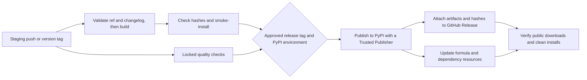

# Release and distribution

## Release identity

| Surface | Release identity |
| --- | --- |
| Project | Drift (Development Environment Version Control) |
| PyPI and application installers | `drift-dev-env` |
| Python import and console command | `drift` |
| GitHub repository | `KiraQiez/Drift` |
| Homebrew tap and formula | `KiraQiez/homebrew-tap` and `drift` |

The `drift` PyPI name belongs to an existing project. The Phase 7 collision checks found no PyPI project under the normalized `drift-dev-env` name or Homebrew core formula named `drift`. The repository maintainer controls the `KiraQiez` GitHub namespace. The distribution name and tap path will be claimed as part of first-release setup. [Existing PyPI project](https://pypi.org/project/drift/)

Development builds use version `0.1.0.dev0`. The first public release targets `0.1.0`.

```sh
brew install KiraQiez/tap/drift
uv tool install drift-dev-env
pipx install drift-dev-env
```

These are planned installations from the project's own tap and PyPI package. Each installer manages the application's Python environment.

## Artifacts and versioning

The release packaging workflow builds one wheel and one sdist with Hatchling through `uv build`. It checks archive contents, metadata, the license, and the console entry point, then uploads both distributions and `SHA256SUMS` as the `distributions` workflow artifact. Every install job verifies those checksums before running the installed console contract.

| Installer | Artifact | Smoke coverage |
| --- | --- | --- |
| uv tool | Wheel | Linux, macOS, and Windows on Python 3.12 and 3.15 |
| pipx | Source distribution | Linux, macOS, and Windows on Python 3.12 and 3.15 |

To reproduce the artifact checks locally, use a fresh output directory.

```sh
uv build --no-create-gitignore --out-dir release-dist
uv run --locked python scripts/check_distributions.py release-dist
uv run --locked python scripts/check_distributions.py release-dist --verify
uv run --locked python scripts/smoke_distribution.py release-dist uv
uv run --locked python scripts/smoke_distribution.py release-dist pipx
```

Use SemVer and a matching Git tag of the form `vMAJOR.MINOR.PATCH`. Use `0.1.0` as the starting target for the first public release. Check that the tag, package metadata, and CLI version agree. Record user-visible changes, fixes, compatibility notes, and manual upgrade steps in [CHANGELOG.md](../CHANGELOG.md). Persisted schema versions follow the separate [data model](DATA_MODEL.md#json-schema-v1).

## Release pipeline



The [release workflow](../.github/workflows/release.yml) runs full quality and packaging checks on each `staging` push and version-tag push. Staging uses the `## Unreleased` changelog section and stops after validation. A release tag must point to a commit reachable from `main` and match the package version. The workflow extracts the single nonempty `## MAJOR.MINOR.PATCH` section as the GitHub release notes.

Before the first approved release, configure these publication controls.

| Control | Setting |
| --- | --- |
| GitHub environment | `pypi`, with release tag access and maintainer approval |
| PyPI pending Trusted Publisher | Project `drift-dev-env`, owner `KiraQiez`, repository `Drift`, workflow `release.yml`, environment `pypi` |
| GitHub repository variable | Set `DRIFT_RELEASE_ENABLED` to `true` once the release setup and approval are in place |

Only the PyPI job can request an OIDC token. After that job succeeds, the GitHub Release job can write release assets. Both jobs check the hashes against the build's record. [PyPI Trusted Publishing](https://docs.pypi.org/trusted-publishers/) · [PyPI security model](https://docs.pypi.org/trusted-publishers/security-model/)

Publish release notes, the validated wheel and sdist, and checksums on GitHub Releases. After PyPI publication, the tap formula uses the published sdist and its digest. Pin a supported versioned Homebrew Python and use its Python virtual environment helper. Generate transitive runtime dependency resources with `brew update-python-resources`, review each resource version and source checksum, and declare the build resources required by the backend where necessary. Run formula validation, installation, and the formula test on a supported macOS runner before merging the tap update. [Homebrew language-specific formulae](https://docs.brew.sh/Language-Specific-Formulae)

## Publication validation and rollback

Verify version and help, initialization, a snapshot and baseline, and a fixture-driven comparison through the installed console command. Validate uv tool and pipx installs from the public package, and install the tap formula on a clean macOS runner. Compare the downloaded artifact digests to the release record. Sign off on the release only after each channel returns the expected version and exit codes.

If a stage fails, record the completed steps and resume the missing stage with the already validated artifacts. If PyPI succeeds and GitHub Release creation fails, rerun the failed GitHub job in the same workflow run. If a published package is broken, document the impact, revert the tap to the last working formula where applicable, and publish a corrected release with a new version. Yank a broken PyPI release when appropriate and provide a reason. Record the fix and recovery steps in the GitHub release notes and changelog. Preserve snapshot compatibility when publishing a fix and test any future migration independently. [PyPI yanking](https://docs.pypi.org/project-management/yanking/)
