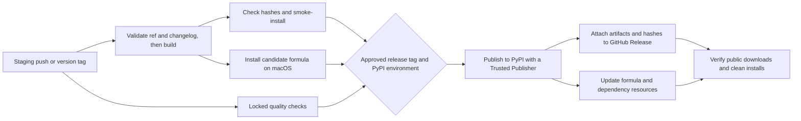

# Release and distribution

## Release identity

| Surface | Release identity |
| --- | --- |
| Project | Drift (Development Environment Version Control) |
| PyPI and application installers | `drift-dev-env` |
| Python import and console command | `drift` |
| GitHub repository | `KiraQiez/Drift` |
| Homebrew tap and formula | `KiraQiez/homebrew-tap` and `drift` |

Version 0.2.0 introduces one-command baseline setup and clearer comparison reports. The wheel and source distribution downloaded from PyPI and GitHub Releases matched the tagged build's SHA-256 checksums. Fresh uv tool, pipx, and Homebrew installs passed the CLI contract. [PyPI 0.2.0](https://pypi.org/project/drift-dev-env/0.2.0/) · [GitHub Release v0.2.0](https://github.com/KiraQiez/Drift/releases/tag/v0.2.0) · [Public tap checks](https://github.com/KiraQiez/homebrew-tap/actions/runs/45855324976)

```sh
brew install KiraQiez/tap/drift
uv tool install drift-dev-env
pipx install drift-dev-env
```

Each installer manages the application's Python environment. The public tap runs install and CLI checks on Apple Silicon and Intel macOS. [Homebrew tap](https://github.com/KiraQiez/homebrew-tap)

## Artifacts and versioning

The release packaging workflow builds one wheel and one sdist with Hatchling through `uv build` using hashed constraints from the locked build group. It checks archive contents, metadata, the license, and the console entry point, then uploads both distributions and `SHA256SUMS` as the `distributions` workflow artifact. Twine validates publishing metadata before the upload. Every install job verifies those checksums before running the installed console contract.

| Installer | Artifact | Smoke coverage |
| --- | --- | --- |
| uv tool | Wheel | Linux, macOS, and Windows on Python 3.12 and 3.15 |
| pipx | Source distribution | Linux, macOS, and Windows on Python 3.12 and 3.15 |

To reproduce the artifact checks locally, use a fresh output directory.

```sh
mkdir -p build
uv export --locked --only-group build --no-emit-project --output-file build/build-constraints.txt
uv build --no-create-gitignore --build-constraints build/build-constraints.txt --require-hashes --out-dir release-dist
uv run --locked python scripts/check_distributions.py release-dist
uv run --locked python scripts/check_distributions.py release-dist --verify
uv run --locked python scripts/smoke_distribution.py release-dist uv
uv run --locked python scripts/smoke_distribution.py release-dist pipx
```

Use SemVer and a matching Git tag of the form `vMAJOR.MINOR.PATCH`. Use `0.1.0` as the starting target for the first public release. Check that the tag, package metadata, and CLI version agree. Record user-visible changes, fixes, compatibility notes, and manual upgrade steps in [CHANGELOG.md](../CHANGELOG.md). Persisted schema versions follow the separate [data model](DATA_MODEL.md#json-schema-v1).

## Release pipeline



The [release workflow](../.github/workflows/release.yml) runs full quality and packaging checks on each `staging` push and version-tag push. Staging uses the `## Unreleased` changelog section and stops after validation. A release tag must point to a commit reachable from `main` and match the package version. The workflow extracts the single nonempty `## MAJOR.MINOR.PATCH` section as the GitHub release notes.

The first release used these publication controls.

| Control | Setting |
| --- | --- |
| GitHub environment | `pypi`, with release tag access and maintainer approval |
| PyPI Trusted Publisher | Project `drift-dev-env`, owner `KiraQiez`, repository `Drift`, workflow `release.yml`, environment `pypi` |
| GitHub repository variable | `DRIFT_RELEASE_ENABLED=true` enables publishing for validated version tags |

Only the PyPI job can request an OIDC token. After that job succeeds, the GitHub Release job can write release assets. Both jobs check the hashes against the build's record. [PyPI Trusted Publishing](https://docs.pypi.org/trusted-publishers/) · [PyPI security model](https://docs.pypi.org/trusted-publishers/security-model/)

## Homebrew tap

The [formula template](../packaging/homebrew/drift.rb.in) uses Homebrew's Python 3.14 virtual environment helper. The renderer selects compatible PyPI wheels for Apple Silicon and Intel from the locked runtime and Hatchling build dependencies. Homebrew checks each resource's SHA-256 hash before using it. The formula builds the Drift sdist with those resources and installs it without resolving packages from the network. [Homebrew language-specific formulae](https://docs.brew.sh/Language-Specific-Formulae)

The release workflow renders a candidate from the validated sdist in a temporary local tap on Apple Silicon and Intel macOS runners. The candidate and public tap checks put runner-provided third-party tap checkouts aside and use a fresh Homebrew trust configuration. They check the Drift formula’s Ruby syntax, install the formula, run `brew test`, and run the same fixture-based console contract as the Python installer jobs. The candidate uses the local archive URL from that workflow run.

For a tap update, use the release tag's checkout and the validated files from its workflow. Refresh the locked dependencies with `uv lock` when the package requirements change. Keep the `build` group aligned with `[build-system].requires`. After PyPI publication, set `PYPI_SDIST_URL` to the published source file URL, verify the downloaded source digest against `SHA256SUMS`, and render the formula.

```sh
uv run --locked python scripts/check_distributions.py release-dist --verify
mkdir -p build path/to/homebrew-tap/Formula
uv export --locked --no-dev --group build --no-emit-project --format pylock.toml --output-file build/pylock.toml
uv run --locked python scripts/render_homebrew.py release-dist/*.tar.gz build/pylock.toml \
  path/to/homebrew-tap/Formula/drift.rb --source-url "$PYPI_SDIST_URL"
```

Review the formula's source and dependency changes and exercise the tap update on macOS before merging it into `KiraQiez/homebrew-tap`.

## Publication validation and rollback

Verify version and help, initialization, a snapshot and baseline, and a fixture-driven comparison through the installed console command. Validate uv tool and pipx installs from the public package, and install the tap formula on a clean macOS runner. Compare the downloaded artifact digests to the release record. Sign off on the release only after each channel returns the expected version and exit codes.

If a stage fails, record the completed steps and resume the missing stage with the already validated artifacts. If PyPI succeeds and GitHub Release creation fails, rerun the failed GitHub job in the same workflow run. If a published package is broken, document the impact, revert the tap to the last working formula where applicable, and publish a corrected release with a new version. Yank a broken PyPI release when appropriate and provide a reason. Record the fix and recovery steps in the GitHub release notes and changelog. Preserve snapshot compatibility when publishing a fix and test any future migration independently. [PyPI yanking](https://docs.pypi.org/project-management/yanking/)
